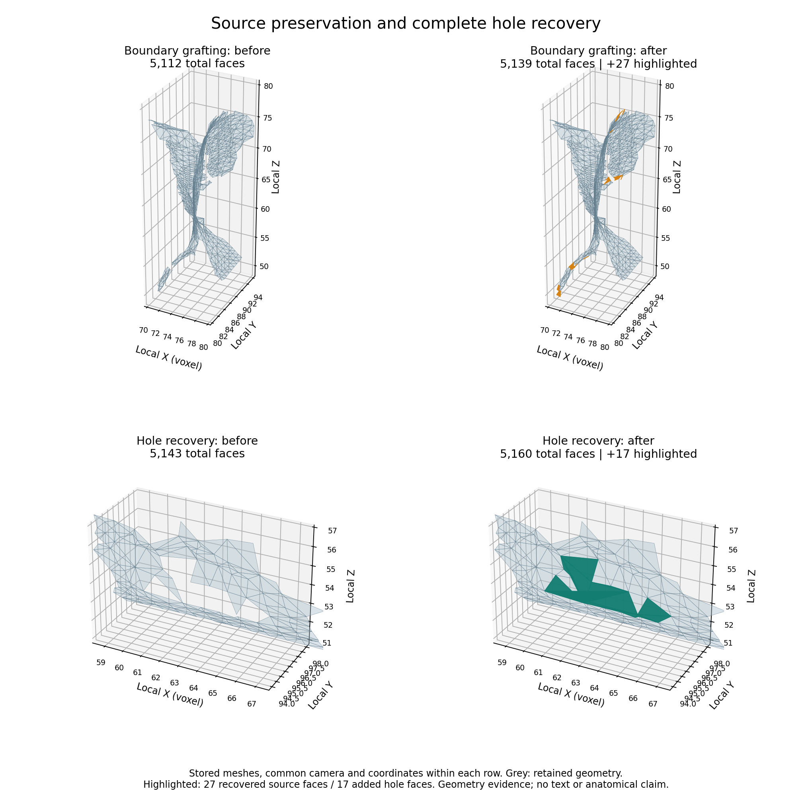

# Measured results and limitations

## Principal before/after comparisons

| Comparison | Control | Contribution | Interpretation |
|---|---:|---:|---|
| Source faces after separation/BPA, pre-graft versus graft v2 | 5,112 | 5,139 | 27 compatible original faces recovered; old source retained |
| Hole-fill final faces, conservative v4 versus v5 | 5,143 | 5,160 | All 5,139 source faces and four other valid fills retained; 17 hole faces recovered |
| Forbidden new/source and new/new contacts, rational audit | — | 0 in 267 exact pairs | Does not audit unchanged source/source pairs |
| Final exact duplicates / degenerate faces, v5 case | — | 0 / 0 | Saved binary32 geometry |
| Annotated proximity coverage, pre-graft versus graft v2 | 2,237 | 2,241 | Recorded finite sampling/radius protocol; includes more than one annotation ID |
| Annotated proximity coverage, hole v4 versus v5 | 2,239 | 2,241 | Distinct immediate baseline from the graft comparison |
| Maximum at 427 boundary probes, pre-graft versus graft | about 1.312 vox | about 0.760 vox | Sampled distance, not anatomical identity |

Do not add counts or gains across different baselines. In particular, the earlier graft-only v2 result retained a known hole-fill conflict; later duplicate correction and v5 recovery are separate documented stages. The conservative v4 removes invalid generated geometry while preserving source; v5 subsequently recovers the complete missing fill.

The figure uses stored meshes, shared views and highlighted added faces. It is a geometry illustration, not an ink image, fiber-following result or same-sheet certificate. Its input and image hashes are recorded in `figures-v2/provenance.json`. The first layout is retained in `figures/`; v2 corrects label spacing without changing any geometry or camera.

## Evidence map

All paths below are relative to `evidence/research/`:

- `scrollfiesta-comparison/BOUNDARY_GRAFT_REPORT.md`: original graft controls, full comparisons, coverage definition, retained conflict and limitations.
- `scrollfiesta-comparison/boundary-graft-results.json`: complete graft measurements.
- `scrollfiesta-comparison/HOLEFILL_DUPLICATE_REPORT.md`: duplicate provenance, conservative correction and regressions.
- `scrollfiesta-comparison/hole-recovery-v5/FULL_RECOVERY_REPORT.md`: full v5 pipeline, regression, coverage and continuity scope.
- `scrollfiesta-comparison/hole-recovery-v5/saved-evaluation-02/strict.json`: rational new-face contact certificate.
- `scrollfiesta-comparison/hole-recovery-v5/continuous-coverage-02.json` and `continuous-coverage-witness-replay-01.json`: saved continuous geometric coverage evidence and witness replay; do not interpret it as anatomy or core welding.
- `scrollfiesta-comparison/hole-recovery-v5/regressions-v5-01/` and `halo-regressions-v5-01/`: recorded regression checks.
- `scrollfiesta-comparison/hole-recovery-v5/source-v5/`: preserved production source used to define this release's hole-recovery stage.

`evidence-index.json` gives exact hashes and explicitly identifies external arrays/executables and the changed historical working-context reference. Historical Spanish reports remain unchanged; these release documents provide the English interpretation and entry points.

## What has not been demonstrated

This is a limited real-data software contribution. There is no verified new text, full-scroll reconstruction, same-sheet or fiber certificate, current-upstream integration or independent generalization to every scroll. Native predicates can miss certain shared-point contacts. The rational audit covers pairs involving added faces, not every unchanged source pair. Failed candidates, incomplete calibration and rejected seam work remain evidence of limitations rather than successful results.

## Verified release path

See `VERIFICATION.md` and `verification/` for the clean build, exact final-file match, direct online input retrieval, resource receipts and archive-integrity checks. No guarantee of a prize follows from passing these checks.
