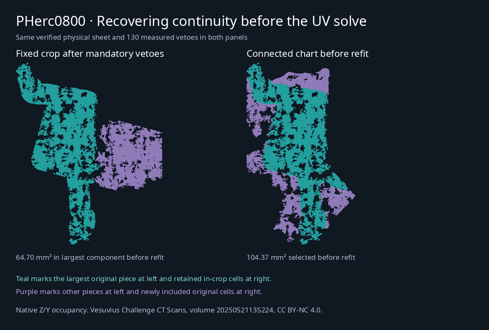
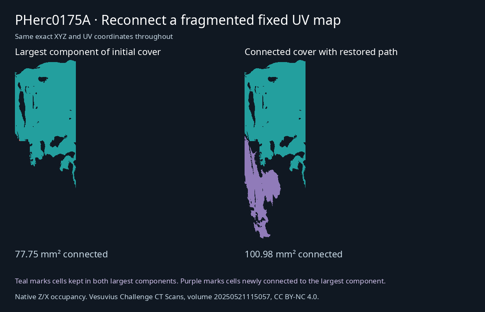

# Recovering connected charts for papyrus unwrapping

A fixed UV crop can split a physically verified papyrus sheet when the first fit rejects cells on a narrow connection. This tool grows a replacement UV input through original shared edges on the same reconstructed sheet. It excludes the mandatory vetoes from the first fit and keeps the face budget fixed. The replacement chart can then enter the same UV fit and certification pipeline.



## PHerc0800 worked example

| Outcome on the same original physical reconstruction | Fixed crop | Connectivity-aware crop |
| --- | ---: | ---: |
| Largest component after the UV cover | 64.659 mm² | 104.166 mm² |
| Conservative native rail accepted | None | 26.074 mm |
| Faces in the UV input | 2,466,712 | 2,498,952 |

The connected result retained 61.10% more area in its largest component than the fixed-crop baseline. The final UV chart contains 2,494,102 original faces, with zero invalid UV faces and zero reported face or boundary contacts. The original face coordinates survive. The geometry input and audit history are bound in [comparison.json](data/comparison.json). This comparison is against our earlier fixed-crop workflow on one sheet. A direct benchmark against VC3D remains open.

See [observed CT](data/observed-ct.png) for the flattened texture after later signed identity and sampling checks, and [native CT stations](data/native-ct-stations.png) for RAW and the surface prediction at five stations. The [native mesh overlay](data/native-mesh-overlay.png) plots original mesh edges on the same local CT cuts. The later raster has 102.953 connected projected mm². Those values describe geometry and observed CT. This case has no confirmed new ink or text.

## PHerc0175A worked example

A complementary tool repairs the cell selection **after** UV fitting. It reconnects the two largest pieces of an existing fixed-UV contact cover by restoring a short connected path and removing its conflicting cells. The solver is not rerun and the replacement cannot move the native or UV vertices. The result still needs a complete boundary and overlap audit.



On the same saved PHerc0175A map and contact audit, the connected area rose from **77.749 to 100.981 mm² (+29.88%)**. The 32-cell path restored 30 cells and removed 63 conflicting cells. The final 2,096,662-face mesh retained the complete 28.005 mm native rail and passed the independent UV certificate with zero invalid faces or contacts. The included replay reproduces all original source face IDs, XYZ and UV exactly. The later [observed CT](data/pherc0175a/observed-ct.png) covers 100.852 connected projected mm² after further identity, sampling and CT checks. See the [native mesh overlay](data/pherc0175a/native-mesh-overlay.png) and the [measured comparison](data/pherc0175a/comparison.json).

## Replay

Both replays run offline from physically checked fixtures. The PHerc0800 replay selects a new UV input and includes the archived certified mesh from its later fit. The PHerc0175A replay starts from a saved UV map and reselects its output faces. The CT-to-mesh reconstruction, UV solver and independent UV auditor are prior stages whose measurements are included separately.

With Python, NumPy and SciPy already available, run from the extracted directory:

```bash
sha256sum -c SHA256SUMS
python tools/select_chart.py data/pherc0800-physical-chart-fixture.npz my-chart
python tools/reconnect_cover.py data/pherc0175a/fixed-uv-fixture.npz my-fixed-chart
```

The run should retain **1,249,476 whole cells** and report **104.371985 mm² before UV refitting**, including **37.318732 mm² outside the earlier crop**. Use a fresh output directory. The package was verified with Python 3.14, NumPy 2.5.4 and SciPy 1.18.1.

- `my-chart/chart.npz` contains exact native Z/Y/X vertices, quads and original cell IDs.
- `data/pherc0800-certified-chart.obj` contains the archived UV triangle mesh. OBJ positions use native X/Y/Z voxel coordinates. Texture coordinates preserve the solver's UV units. The OBJ and the public CT raster are separate inspection artifacts.
- `data/pherc0800-certified-chart-lineage.npz` maps OBJ triangle order to original face IDs.

- `my-fixed-chart/chart.npz` contains the selected PHerc0175A native triangle mesh and unchanged vertex UV. `selection.npz` records baseline and final source cell IDs.

## Use on another chart

Supply a NumPy archive with `native_zyx` (V×3 native voxel coordinates), `quads` (Q×4 vertex indices ordered lower Z/Y, +Z, +Y, +Z/+Y), sorted unique `source_quad_ids`, `baseline_ids`, `veto_ids` and scalar `pitch_mm`. The quad support must be single-valued along X, with matching original edges. The baseline and veto lists come from a complete first-pass UV audit. This stage leaves those vetoes excluded. Use the output as the input to a new UV solve, then recheck distortion, overlap and physical correspondence before rendering.

For the fixed-map method, `reconnect_cover.py --help` shows the command. Use a complete audited contact list and a grid of original cells with native shared-edge adjacency already verified. The fixture adds `mapped` (row-major cell sites), `shape`, `area_native_voxels2`, `mandatory` (hard veto mask), `conflicts` (pairs of cell indices, including self-vetoes), `rail_cells` (ordered local cell indices), `source_cell_ids`, and the original triangle arrays `native_zyx`, `faces`, `source_face_ids`, `uv`. The two face halves must be in matching cell order. A failed bridge attempt leaves the largest baseline component and sets `bridge_accepted` to false. Chart selection always precedes a separate UV audit of the new boundary.

The code and examples use separate licenses. See [software license](tools/LICENSE) and [dataset attribution](data/DATA-LICENSE.md).

The complete example archives, reproducible fixtures and checksums are available from the [November 2026 release](https://github.com/danielcadev/papyrus-atlas/releases/tag/progress-prize-2026-11).
