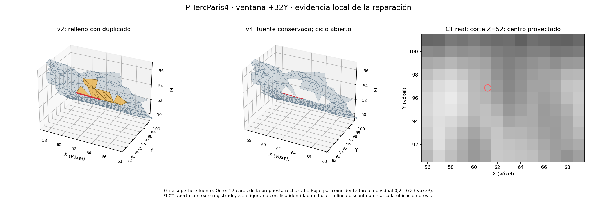

# Duplicado geométrico del relleno — v4

La extensión experimental se basa en ScrollFiesta público, fijado en `bce8a65f97652316efb084171a17d2f1f8d3ae1a`; conservar sus licencias y atribuciones. En la ventana +32 Y, v4 evita el triángulo geométrico duplicado detectado en el relleno, conservando la geometría fuente y la recuperación de borde medida. Es un resultado local, no una demostración de optimalidad, originalidad mundial o corrección universal.

## Cambio y resultado

El par localizado en `step8_holefill` representaba el mismo triángulo con orientaciones opuestas e IDs distintos. En `source/src/holefill/hole_fill.c`, v4 rechaza una propuesta de relleno 3D que contiene un duplicado exacto por coordenadas, incluso con IDs distintos. Conserva el ciclo fuente abierto y permite las demás propuestas: en el replay se aceptó el ciclo válido de seis vértices. El ciclo problemático de 19 vértices permanece abierto. Las 17 caras generadas por la propuesta rechazada no se preservan; no se afirma que su superficie haya sido recuperada por otra vía.

| Medida en +32 Y | v2 | v4 |
| --- | ---: | ---: |
| Caras finales | 5160 | 5143 |
| Cobertura de referencia a radio 1 | 2241 | 2239 |
| Conflictos del auditor 3D | 1 | 0 |
| Borde máximo perdido | 0,760 | 0,759852 |
| Puntos de borde a más de 1 vóxel | 0 | 0 |

La cobertura v1 era 2237. La entrada previa al relleno es idéntica byte a byte a v2. El certificado independiente verificó las 5139 caras fuente con multiplicidad y orientación, sin ausencia ni inversión; se mantienen las 27 caras de recuperación de borde. La comparación registra 16 geometrías únicas eliminadas y ninguna añadida. El guard final indica cero cambios. Los resultados finales de los casos central, +32 X y original son idénticos byte a byte a v2.

## Validación y límites

El replay sobre malla guardada y la prueba focalizada pasaron: incluyen orientación opuesta, IDs separados, hoja cercana y multiplicidad; el auditor reportó cero conflictos. Luego se ejecutó el proceso completo de +32 Y con `Status: OK`, y regresiones central, +32 X y original. El auditor nativo revisó todas las caras con `gap_max=0`, hinges y cuatro controles de predicado: cero overlap, stab y fold. Detecta intersecciones, no certifica separación mínima.

El certificado independiente usa la biblioteca estándar, no importa código nativo, compara coordenadas globales float32 con tolerancia cero y contabiliza multiplicidad y orientación. Certifica coincidencias exactas, no intersecciones generales ni identidad anatómica. Cobertura cuenta vóxeles anotados cerca de muestras de caras y puede incluir varios IDs. La ventana comparte cubo y rollo con el desarrollo; faltan halo, seams, otro cubo o rollo y evidencia visual de identidad de hoja. La estrategia v3 se descartó tras producir nueve `stab` en el caso central: su fuente se conserva en `holefill-repair/hole_fill.v3-rejected.c` y sus logs. Ese resultado muestra que eliminar el duplicado por sí solo no basta para validar un relleno.

## Evidencia y reproducción

- `holefill-repair-v4/y32-comparison.json`, `independent-certificate.json`, `regressions.json` y `replay-audit.json` contienen las mediciones; `sha256.txt` fija código, parche, binarios y herramientas.
- `holefill-repair-v4/holefill-geometric-duplicate.patch` conserva el cambio. `fresh-yplus32-v2/conflict-provenance.json` y `existing-overlap-trace.json` documentan el par anterior.
- Los comandos exactos, estado, límites observados y logs se conservan en `research/native/hf-{build-v4-01,small-v4-02,full-y32-v4-01,regressions-v4-01,certify-v4-01}.{status.json,log}`. Las cinco ejecuciones terminaron con código 0 y GPU inaccesible.
- Para nuevas corridas usar nombres y rutas de salida nuevos, sin sobrescribir evidencia: `research/run_holefill_guarded.sh NOMBRE_UNICO TIMEOUT COMANDO...`. El wrapper aplica los límites de systemd y ejecuta `run_native_guarded.py`. La CLI completa usa `cube_mesh INPUT.tif OUTPUT.tif --dump-obj DIR --no-simplify`, con `MLS_EDGE_ADAPT=soft` y `VES_OVERLAP_COVERAGE_GUARD=1`; el comando concreto de +32 Y está en su archivo de estado. Con halo cero se usa `step11_kibble` tras `Status: OK` y guard cero.

No se ha publicado ni enviado una candidatura. Para una entrega aún hacen falta validación más amplia y empaquetado reproducible con atribuciones.

## Certificado reutilizable y evidencia visual

`research/exact_mesh_certificate.py` separa la certificación de coincidencias y conservación de fuente del núcleo nativo. Su CLI recibe `--before`, `--after`, `--source` opcional y `--output` exclusivo. Valida formato, índices, finitud y ambas codificaciones UV; distingue duplicados degenerados con un producto vectorial entero exacto de las coordenadas binary32. Las 19 pruebas de `test_exact_mesh_certificate.py` pasaron bajo el guard (`hf-independent-tests-01`). El caso real pasó también: `holefill-repair-v4/reusable-certificate.json`, registrado en `hf-independent-real-01`. Es una implementación propia de validación exacta, no un motor independiente de reconstrucción ni un detector general de intersecciones.

La revisión estática independiente de Astra no encontró bloqueantes; véase `holefill-repair-v4/ASTRA_REVIEW.md`. Confirma que retirar solo parte de las 17 caras violaría el certificado de frontera indexada actual: una alternativa requeriría una triangulación completa nueva y su auditoría.

Figura generada de las mallas guardadas y `raw.npy` real, revisada visualmente; procedencia y hashes en `holefill-ct-evidence-v2.json`. El CT se muestra como contexto registrado a Z=52, sin afirmar seguimiento de fibras ni identidad de hoja. Los colores distinguen explícitamente las caras generadas que se rechazan de la fuente conservada.

## Ampliación posterior

La comparación +32Z con halo13 ya se ejecutó sin ajustar parámetros: cuatro casos correctos, fuente conservada, salidas v2/v4 byteidénticas y unión de 13346 caras sin duplicados ni cruces auditados. El [informe de halo](HALO_VALIDATION_REPORT.md) registra también las distancias de borde y sus límites: no hay soldadura ni prueba de identidad anatómica, y se observan puntos de banda a más de 4 vóxeles del otro core. Sigue pendiente validación en otro cubo o rollo y evidencia de fibras.
