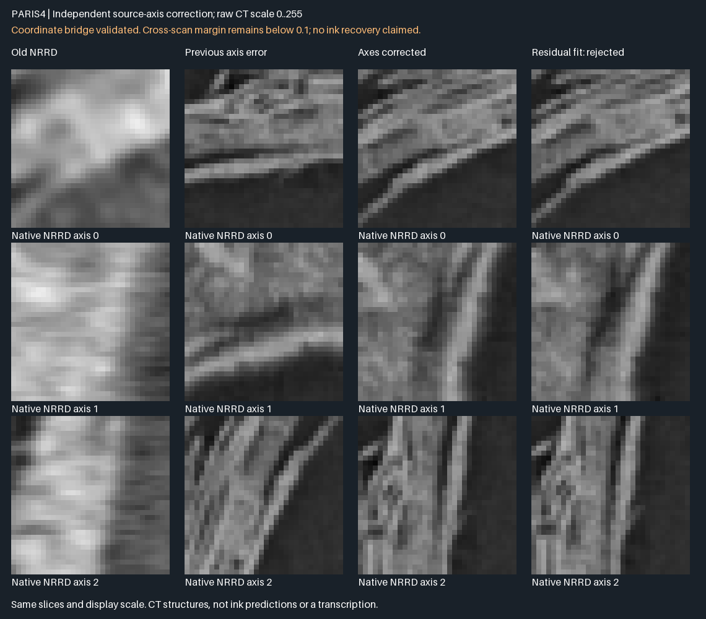

# Paris4 coordinate audit

This is a research correction, not a recovered-text milestone. [Full report](REPORT_EN.md).

The specific public Paris4 NRRD cube uses native ZYX indices. The earlier atlas bridge incorrectly treated them as XYZ. An independent same-scan test selects the corrected convention (reserved-plane Pearson 0.999051). Corrected modern CT Pearson improves to 0.842303; controlled residual fits reach 0.858298, but their margin remains 0.091650 versus the unchanged 0.1 minimum. Registration is still rejected. Corrected added-face prediction scores are weak; no real ink or recovered letters are demonstrated.



## Reproduce the coordinate finding

From the repository root, with a unique output path and job name:

```bash
bash tools/run_guarded.sh paris4-axis-review-01 180 python3 -I -S "$PWD/research/paris4-coordinate-audit/reproduce_axes.py" /tmp/paris4-axis-review-01
```

This uses Python's standard library, downloads the two SHA-pinned public objects in `SOURCES.json`, checks their bytes, and tests 48 signed conventions on 4,096 points with reserved validation planes. It writes all results and source receipts. The documented online command was independently executed with site packages disabled and passed. It needs network access for this data audit; the geometry algorithms themselves still run offline without these data or this audit.

To replay from local objects without network, add `--offline-objects-json FILE`; FILE is a JSON mapping from each SHA256 in `SOURCES.json` to its existing local object path. Inputs are read-only; output paths cannot already exist. Public data retain their original EduceLab terms and are not vendored into this repository.

## What is preserved here

`evidence/` contains the recorded source-axis result, fresh portable replay, CT diagnostic results, corrected prediction-coverage results, additional sampled positions, every raw-score threshold and the independent verifier receipt. Original frozen lab phases remain intact; older incorrect-coordinate score associations are superseded for physical interpretation. Corrected weak prediction scores do not prove absence of physical ink.

`lab-source-snapshots/` preserves the more extensive CT/score experiments and the corrected lab bridge sources for audit. These snapshots require the original lab fixture/data layout, NumPy, Pillow and, for fitting, SciPy; they are not claimed to run from this small package alone. The portable command above independently reproduces the source-axis finding, not the entire CT registration or ink pipeline. Prior input hashes in result records refer to their preserved lab files.

The source meshes, recovered faces, geometry algorithms, eight-test geometry result and earlier release archives were not changed. No new letter, better reading accuracy, anatomical error bound or prize qualification is claimed. The application remains unchanged.
